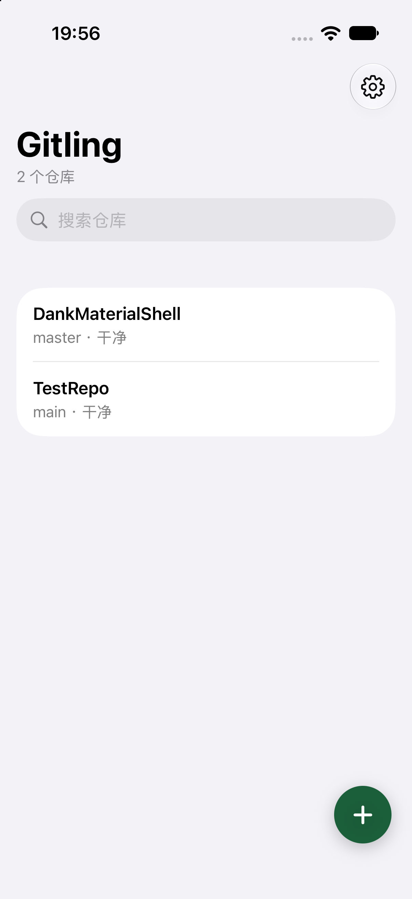
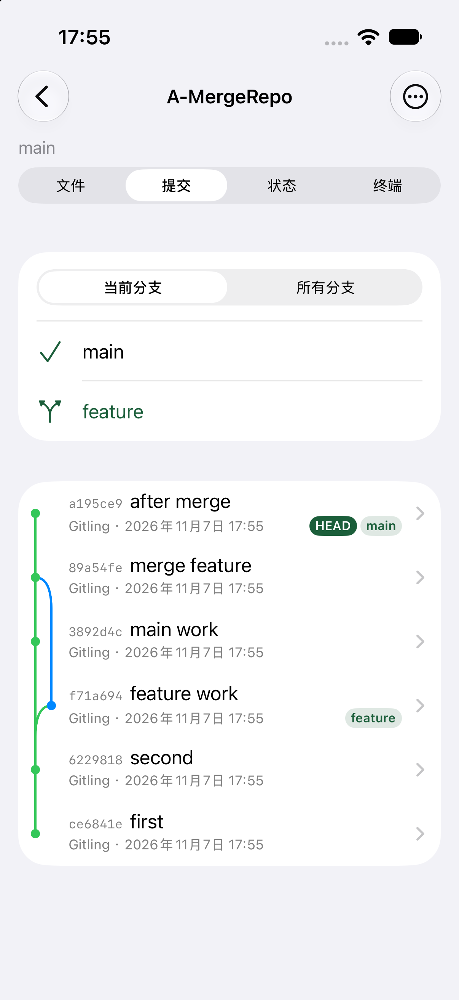
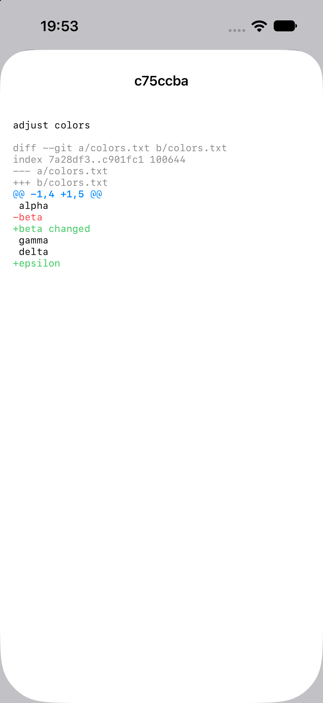
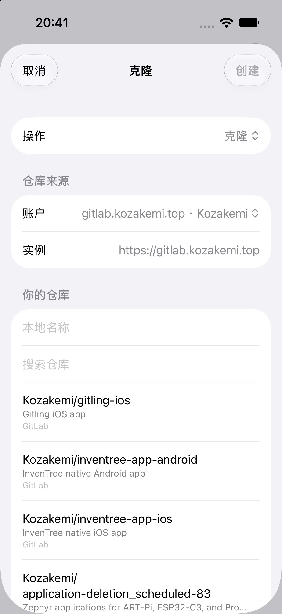
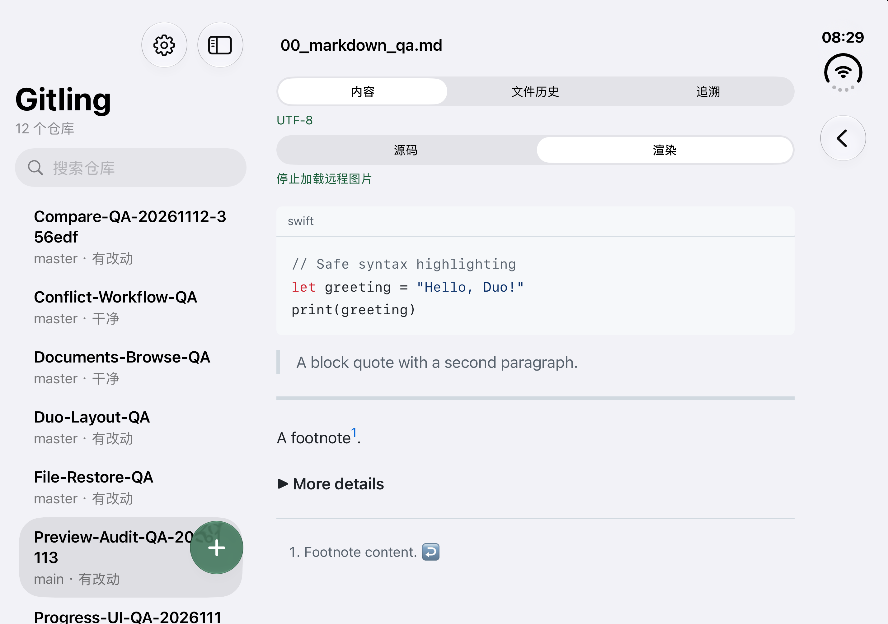

# Gitling for iOS

English | [简体中文](README.zh-CN.md)

[](https://github.com/kozakemi/gitling-ios/actions/workflows/build-ipa.yml)

An open-source Git client for iPhone and iPad, built with SwiftUI and libgit2.

> **Unofficial version**
>
> This project is maintained by community developers and is not affiliated with,
> authorized by, or endorsed by the original author, Maneesha Cooray.
> The features and interaction are inspired by the Android version of
> [Gitling](https://github.com/maneeshacooray/Gitling); the iOS code is an
> independent implementation.

Gitling for iOS brings the Gitling mobile Git workflow to iOS: clone repositories,
browse history and diffs, commit, and push. Workspaces are exposed in the Files app
so other editors can modify files.

## Features

- Swipe between file contents, history and blame; swipe Diff and Markdown selectors while keeping content horizontal scrolling available
- Reset a damaged terminal environment from Settings; reopen the app to restore bundled offline tools

- Persistent offline Linux shell with PTY, live ANSI output, Ctrl-C, resizing and repository sharing; native Git/File Provider operations are protected while a shell is active

- Copy-import existing repositories while preserving the source, full local Git data, and uncommitted state; convert bare repositories offline

- Stage and unstage individual files, with separate working-tree and staged diffs
- Restore individual working files from the index, including deleted files, while preserving staged changes
- Save, list, apply, pop, and delete stashes, optionally including untracked files
- Recoverable merge/rebase/cherry-pick conflicts: inspect both sides and the working file, import external edits, confirm resolutions, continue or abort
- Submodule status, initialization, updates, and recursion, with dirty-worktree protection and resumable failures
- Tag lists, details, and safe checkout with explicit detached HEAD state and local-change protection
- Tap the copy control in commit lists or tap a commit hash in details to copy its full OID
- Full-history search by message, author/email and OID; recursive file name/path search with cancellation and pagination
- File history, historical versions, worktree blame with commit navigation, and basic syntax highlighting
- Compare any two fixed commits, browse changed files, and switch between their file previews
- Read-only worktree and historical previews for images, PDF, system-supported Office/RTF/iWork documents, and audio/video; binary hex paging and ZIP directory listings
- Markdown opens rendered by default, with GFM tables, task lists, footnotes, alerts, code highlighting, and repository-relative images. Remote images load only after tapping the prompt; text and source previews have a persistent line-number toggle
- Live Git operation progress, including LFS download bytes and percentages. The home screen shows branch metadata first and refreshes status per repository in the background
- Support `feature/topic` branch names, branch renaming, and safe deletion of merged branches
- Set or clear upstream branches; select a remote for Fetch/Push, with default sync following the upstream remote and branch name

- Clone HTTPS repositories and initialize local repositories
- Commit, stage, unstage, fetch, pull, and push
- Browse commit history, branch graphs, and commit diffs
- Large histories load in pages with a bottom loading indicator
- Use a dropdown branch picker for long branch lists, with all local and remote-tracking branches available
- Checkout a selected local branch, or create a local tracking branch from a remote branch
- Colorized commit diffs: additions in green, deletions in red, hunk headers in blue,
  file headers in gray
- Chinese, English, and Japanese interfaces
- Gitling location in the Files app through a File Provider extension
- Link an external folder from the Files app as the working tree
- GitHub Device Flow sign-in
- GitLab.com and self-hosted GitLab, with multiple accounts per platform
- HTTP, HTTPS, and SSH transports; import an existing SSH private key and link it to a clone
- SSH host keys use trust-on-first-use and reject a changed key
- Git LFS pointer download and checkout, plus clean/upload of LFS-tracked files
- Personal Access Tokens stored in the Keychain, never in `.git/config`
- New repositories default to local initialization; when cloning, choose an account
  first and only then load that account's remote repositories
- The add button uses Liquid Glass on iOS 26 and falls back to the solid brand button
  on iOS 18

## Screenshots

| Home | Commit history and graph |
| --- | --- |
|  |  |

| Colorized diff | GitLab project picker |
| --- | --- |
|  |  |

iPhone Duo / iOS 27.2 simulator, unfolded display: repository sidebar and Markdown preview using an existing offline fixture (2026-11-16).



iPad Pro 13 / iOS 18.6 simulator: terminal and environment reset settings (2026-11-16).

| Terminal | Reset settings |
| --- | --- |
|  |  |

## Requirements

- iOS 18.0 or later
- Xcode 26 / 27
- Swift 5
- libgit2 1.8.4 and libssh2/OpenSSL (static, prebuilt libraries are included)
- No CocoaPods or external Swift Package downloads required

## Build

```sh
open Gitling.xcodeproj
```

Select the `Gitling` scheme and a simulator or device in Xcode.

Build an unsigned IPA:

```sh
./scripts/build-ipa.sh
```

The output is `build/Gitling.ipa`. An unsigned IPA cannot be installed directly on a device.
The ordinary Xcode and IPA builds include the hardened iSH arm64 kernel, SwiftTerm,
an Alpine rootfs and 25 pinned APKs, including Git, Vim and nano. The first developer build downloads
checksummed artifacts; later builds reuse `build/ish-prototype` offline. The
installed app initializes Git, Vim and nano without network access. Builds require an Apple
Silicon Mac (the embedded simulator runtime is arm64).

Entering a repository starts its shell automatically. `/shared` is the selected
worktree; linked external folders also use `/gitdata` for that repository's Git
metadata. The shell and scrollback remain alive when switching or swiping tabs.
Other tabs park the complete Guest process tree before granting native Git and
Files access; returning to Console reacquires the exclusive gate before resuming.
Directory, environment and background jobs are preserved, with jobs paused while
the terminal is hidden. Leaving the repository cancels its tree. Backgrounding
parks the session; iOS may still terminate the application. Keyboard Ctrl-C remains
available, and **Stop Shell** explicitly ends a session. Delete/link/unlink require
ending the session first to keep its mounted workspace identity stable. This is
Linux userspace inside iOS, not a macOS host shell. See [runtime sources and notices](Vendor/IshRuntime/README.md).

Manual commands can remove the shell, Git, editors or startup configuration.
**Settings → Reset Terminal Environment** stages a clean copy for the next app
launch. It removes all private Linux files, including repositories cloned inside
that private environment. Gitling-managed repositories, linked folders, commits
and saved app credentials are kept. Reset does not undo shell changes to shared
repository files.

GitHub Actions also builds the unsigned IPA on every push to `main`, on pull
requests, and on manual dispatch. Open the latest run on the
[Actions page](https://github.com/kozakemi/gitling-ios/actions/workflows/build-ipa.yml)
and download the `Gitling-unsigned-ipa` artifact. The artifact is unsigned; sign
it with your own certificate and provisioning profile before installing it.

If libgit2 is not already built, the script invokes `scripts/build-libgit2.sh`.
You can also build it manually first:

```sh
./scripts/build-libgit2.sh
```

## Tests and checks

```sh
./scripts/test.sh
```

Local tests use the simulator allowlist configured in the test script and disable
parallel simulator cloning. CI uses an existing
device on its temporary host.

Latest local validation (2026-11-16): **356/356 tests passed on each of iPhone / iOS 18.6,
Duo QA / iOS 27.2 and iPad Pro 13 / iOS 18.6, with no failures or skips**.
Coverage includes terminal lifecycle, reset rollback, swipe boundaries and lazy
file history/blame loading. An actual two-launch iPad recovery check restored
Git, Vim, nano and the shell after deletion, preserving the native repository
and app preferences. The unsigned generic iOS Release
IPA with verified offline terminal dependencies, localization checks, and strict simulator app signatures also passed.
Simulator checks do not replace physical-device or third-party file-provider acceptance.

Localization coverage check:

```sh
./scripts/check-localizations.py
```

## Project layout

```text
Gitling/                 iOS app, UI, accounts, SSH/LFS, GitHub/GitLab clients
GitlingFileProvider/     Files app File Provider extension
Shared/                  Repository storage, worktree, write lock, File Provider sharing
GitlingTests/            XCTest unit tests
Vendor/static-libgit2/   libgit2 static xcframework and local Swift Package
Vendor/libssh2/          Prebuilt libssh2/OpenSSL static libraries and licenses
scripts/                 Build, IPA, and localization scripts
docs/                    Application screenshots
```

## Accounts and credentials

- GitHub uses Device Flow; no account password is stored in the app.
- GitLab uses a Personal Access Token. Recommended scopes:
  - `read_api`
  - `read_user`
  - `read_repository`
  - `write_repository`
- Account tokens are stored in the Keychain per account.
- After a successful clone, the repository records the account it used; later
  fetches and pushes prefer that account.
- Multiple accounts are supported for both GitHub and GitLab.

## Known limitations

- Copy import requires self-contained Git data. External `.git` directories, shared object stores, and promisor dependencies are rejected to avoid incomplete copies or writes back to the source.

- A conflicted stash restore keeps the stash and conflict contents. Use the conflict resolution screen to inspect, import edits, and confirm each resolved file.

- SSH keys are imported, not generated or exported. The passphrase is stored in the Keychain.
- SSH host keys use trust-on-first-use. A changed host key is rejected; there is no known-hosts management UI yet.
- Git LFS supports pointer download/checkout, clean/upload, and live download progress. LFS locking, resumable transfers, and disk-backed download buffering are not implemented.
- Text previews retain a 256 KiB budget; historical blobs and ordinary preview files are limited to 32 MiB. These limits are not hard decoder-memory guarantees. GIF previews use the first frame; encrypted PDFs are not unlocked, SVG/HTML remain source text, and ZIP contents are not extracted.
- Markdown does not support every GitHub extension: math, Mermaid, and complete emoji shortcodes are not rendered. Repository images follow the worktree or the same fixed commit; path escapes and symlinks are rejected, and LFS pointers are not downloaded automatically.
- HTTP is supported for compatibility with local or legacy servers. It sends credentials and data in clear text; use HTTPS whenever possible.
- Interactive rebase and custom merge drivers are not supported.
- Commit diffs treat files larger than 256 KB as binary to keep the UI responsive.
- GPLv3 and App Store distribution terms have known compatibility disputes. If you
  plan to publish on the App Store, complete a license audit and consider dual
  licensing or an App Store exception. This is not legal advice.
- This is an unofficial client. Verify the use of the project name, icon, and
  trademarks before distributing.

## Third-party licenses

- [libgit2](https://libgit2.org/) — GPL-2.0 with Linking Exception
- [libssh2](https://www.libssh2.org/) — BSD-3-Clause; see `Vendor/libssh2/LICENSE-libssh2`
- [OpenSSL](https://www.openssl.org/) — Apache-2.0; see `Vendor/libssh2/LICENSE-OpenSSL`
- [Marked](https://github.com/markedjs/marked) — MIT; [license](Gitling/MarkdownAssets/MARKED-LICENSE.txt)
- [marked-footnote](https://github.com/bent10/marked-extensions) — MIT; [license](Gitling/MarkdownAssets/MARKED-FOOTNOTE-LICENSE.txt)

Markdown parser versions, source URLs, and checksums are recorded in
[MarkdownAssets/NOTICE.txt](Gitling/MarkdownAssets/NOTICE.txt). The parsers are bundled
for offline use; the preview does not download scripts from a CDN.

## License

This project is released under the
[GNU General Public License v3.0](LICENSE).

Original Gitling for Android:

- Author: Maneesha Cooray
- Project: https://github.com/maneeshacooray/Gitling
- License: GPLv3

This repository: https://github.com/kozakemi/gitling-ios
