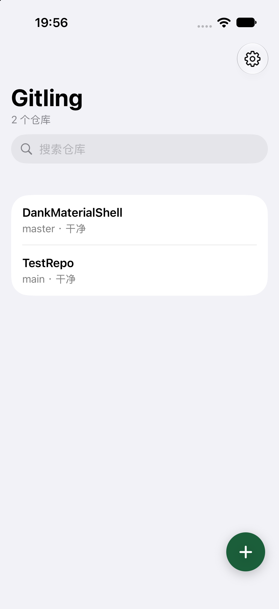
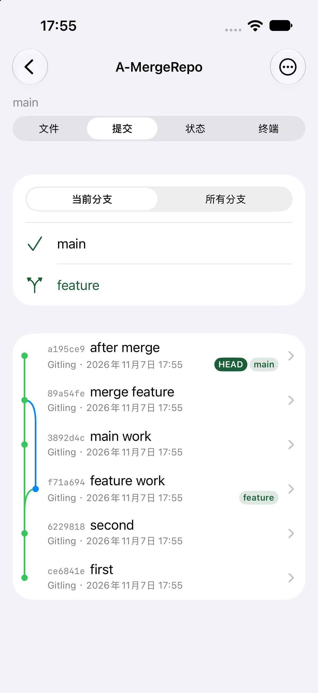
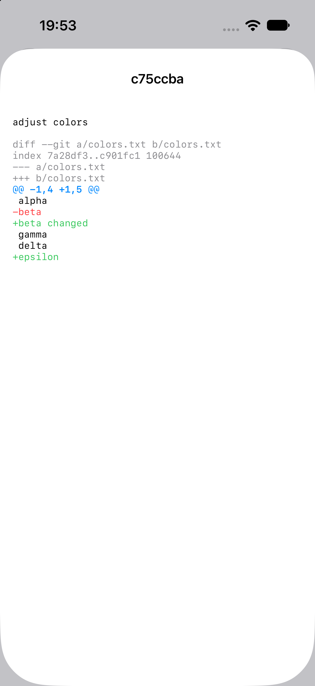
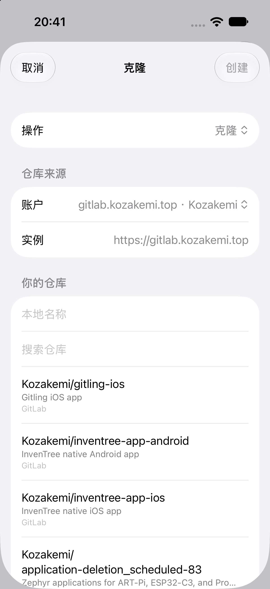

# Gitling for iOS

English | [简体中文](README.zh-CN.md)

An open-source Git client for iPhone and iPad, built with SwiftUI and libgit2.

> **Unofficial version**
>
> This project is maintained by community developers and is not affiliated with,
> authorized by, or endorsed by the original author, Maneesha Cooray.
> The features and interaction are inspired by the Android version of
> [Gitling](https://github.com/maneeshacooray/Gitling); the iOS code is an
> independent implementation.

Gitling for iOS brings the Gitling mobile Git workflow to iOS: clone repositories,
browse history and diffs, commit, and push. Workspaces are exposed in the Files app
so other editors can modify files.

## Features

- Clone HTTPS repositories and initialize local repositories
- Commit, stage, unstage, fetch, pull, and push
- Browse commit history, branch graphs, and commit diffs
- Colorized commit diffs: additions in green, deletions in red, hunk headers in blue,
  file headers in gray
- Chinese, English, and Japanese interfaces
- Gitling location in the Files app through a File Provider extension
- Link an external folder from the Files app as the working tree
- GitHub Device Flow sign-in
- GitLab.com and self-hosted GitLab, with multiple accounts per platform
- Personal Access Tokens stored in the Keychain, never in `.git/config`
- New repositories default to local initialization; when cloning, choose an account
  first and only then load that account's remote repositories

## Screenshots

| Home | Commit history and graph |
| --- | --- |
|  |  |

| Colorized diff | GitLab project picker |
| --- | --- |
|  |  |

## Requirements

- iOS 18.0 or later
- Xcode 26 / 27
- Swift 5
- libgit2 1.8.4 (a static xcframework and build script are included)
- No CocoaPods or external Swift Package downloads required

## Build

```sh
open Gitling.xcodeproj
```

Select the `Gitling` scheme and a simulator or device in Xcode.

Build an unsigned IPA:

```sh
./scripts/build-ipa.sh
```

The output is `build/Gitling.ipa`. An unsigned IPA cannot be installed directly on a device.

If libgit2 is not already built, the script invokes `scripts/build-libgit2.sh`.
You can also build it manually first:

```sh
./scripts/build-libgit2.sh
```

## Tests and checks

```sh
xcodebuild \
  -project Gitling.xcodeproj \
  -scheme Gitling \
  -destination 'platform=iOS Simulator,name=iPhone 17' \
  test
```

Localization coverage check:

```sh
./scripts/check-localizations.py
```

## Project layout

```text
Gitling/                 iOS app, UI, accounts, GitHub/GitLab clients
GitlingFileProvider/     Files app File Provider extension
Shared/                  Repository storage, worktree, write lock, File Provider sharing
GitlingTests/            XCTest unit tests
Vendor/static-libgit2/   libgit2 static xcframework and local Swift Package
scripts/                 Build, IPA, and localization scripts
docs/                    Screenshots
```

## Accounts and credentials

- GitHub uses Device Flow; no account password is stored in the app.
- GitLab uses a Personal Access Token. Recommended scopes:
  - `read_api`
  - `read_user`
  - `read_repository`
  - `write_repository`
- Account tokens are stored in the Keychain per account.
- After a successful clone, the repository records the account it used; later
  fetches and pushes prefer that account.
- Multiple accounts are supported for both GitHub and GitLab.

## Known limitations

- SSH transport is currently disabled; HTTPS works.
- Git LFS, interactive rebase, and custom merge drivers are not supported.
- Commit diffs treat files larger than 256 KB as binary to keep the UI responsive.
- GPLv3 and App Store distribution terms have known compatibility disputes. If you
  plan to publish on the App Store, complete a license audit and consider dual
  licensing or an App Store exception. This is not legal advice.
- This is an unofficial client. Verify the use of the project name, icon, and
  trademarks before distributing.

## Development notes

This project was developed with **Grok** and **DeepSeek** as AI coding assistants
for code generation, refactoring suggestions, tests, and documentation. All commits
are reviewed by the maintainer before they are merged.

## License

This project is released under the
[GNU General Public License v3.0](LICENSE).

Original Gitling for Android:

- Author: Maneesha Cooray
- Project: https://github.com/maneeshacooray/Gitling
- License: GPLv3

This repository: https://github.com/kozakemi/gitling-ios
