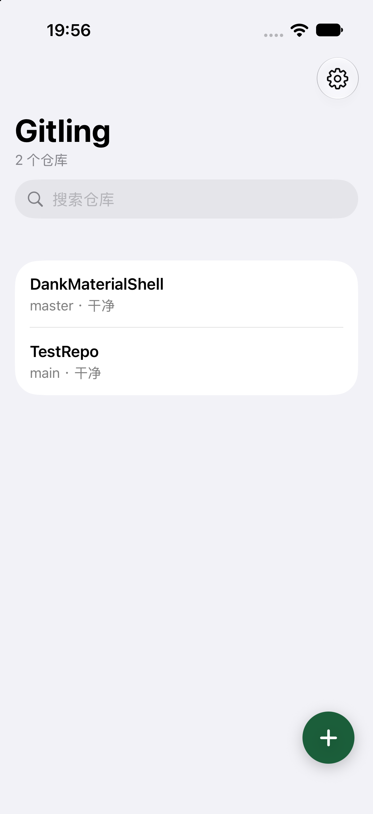
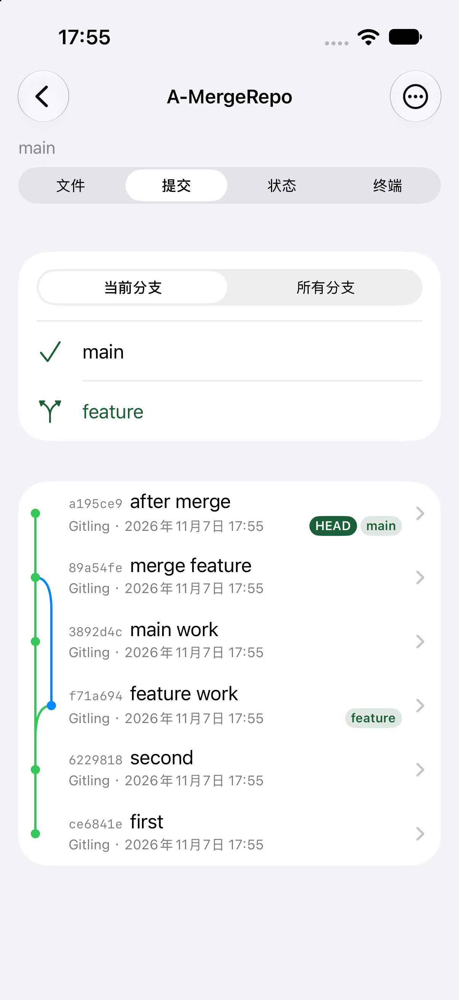
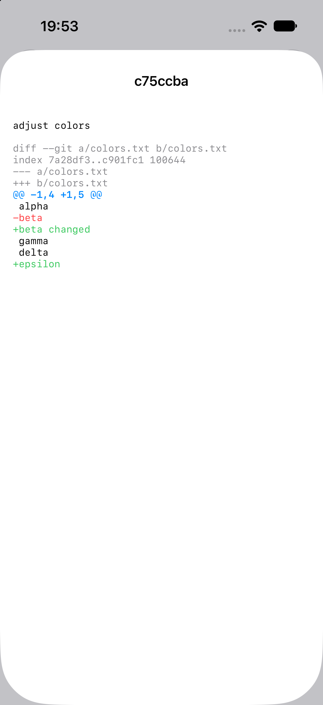
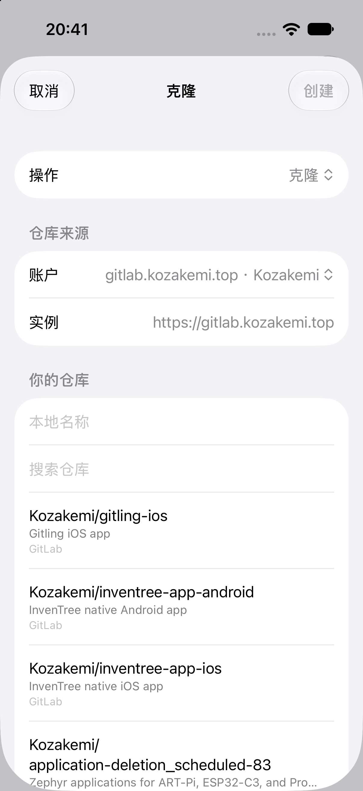

# Gitling for iOS

[English](README.md) | 简体中文

[](https://github.com/kozakemi/gitling-ios/actions/workflows/build-ipa.yml)

一个面向 iPhone 和 iPad 的开源 Git 客户端，使用 SwiftUI + libgit2 实现。

> **非官方版本**
>
> 本项目由社区开发者维护，与原作者 Maneesha Cooray 没有隶属、授权或背书关系。
> 功能和交互参考了 Android 版 [Gitling](https://github.com/maneeshacooray/Gitling)，iOS 代码是独立实现。

Gitling for iOS 的目标是把 Gitling 的移动 Git 工作流带到 iOS：克隆仓库、查看历史和差异、提交并推送，同时把工作区放进「文件」App，方便其他编辑器修改文件。

## 功能

- 克隆 HTTPS 仓库，本地初始化仓库
- 提交、暂存、取消暂存、拉取、抓取、推送
- 查看提交历史、分支图和提交差异
- 提交差异按行着色：新增绿色、删除红色、hunk 蓝色、文件头灰色
- 中文、英文、日语界面
- 通过 File Provider 在「文件」App 中提供 Gitling 位置
- 支持关联「文件」App 中的外部文件夹作为工作区
- GitHub Device Flow 登录
- GitLab.com 和自建 GitLab，支持多个同平台账户
- HTTP、HTTPS 和 SSH 传输；支持导入已有 SSH 私钥并关联到克隆的仓库
- SSH 主机密钥采用首次信任（TOFU），主机密钥变化时会拒绝连接
- Git LFS 指针下载和检出，以及对 LFS 跟踪文件执行 clean/upload
- Personal Access Token 保存到 Keychain，不写入 `.git/config`
- 新建仓库默认本地初始化；克隆时先选择账户，再加载该账户的远程仓库

## 截图

| 首页 | 提交历史与分支图 |
| --- | --- |
|  |  |

| 带颜色的差异 | GitLab 项目选择 |
| --- | --- |
|  |  |

## 环境要求

- iOS 18.0 或更高版本
- Xcode 26 / 27
- Swift 5
- libgit2 1.8.4 与 libssh2/OpenSSL（仓库内提供静态预编译库）
- 不需要 CocoaPods 或外部 Swift Package 下载

## 构建

```sh
open Gitling.xcodeproj
```

在 Xcode 中选择 `Gitling` scheme 和模拟器/设备运行。

构建未签名 IPA：

```sh
./scripts/build-ipa.sh
```

产物在 `build/Gitling.ipa`。未签名包不能直接安装到真机。

GitHub Actions 会在推送到 `main`、提交 Pull Request 以及手动触发时自动编译未签名 IPA。打开
[Actions 页面](https://github.com/kozakemi/gitling-ios/actions/workflows/build-ipa.yml) 的最新运行，
下载名为 `Gitling-unsigned-ipa` 的产物。该产物未签名，安装前需要用你自己的证书和描述文件签名。

如果本机没有预编译的 libgit2，脚本会调用 `scripts/build-libgit2.sh`。也可以手动先构建：

```sh
./scripts/build-libgit2.sh
```

## 测试与检查

```sh
xcodebuild \
  -project Gitling.xcodeproj \
  -scheme Gitling \
  -destination 'platform=iOS Simulator,name=iPhone 17' \
  test
```

本地化覆盖检查：

```sh
./scripts/check-localizations.py
```

## 目录结构

```text
Gitling/                 iOS 应用、界面、账户、SSH/LFS、GitLab/GitHub 客户端
GitlingFileProvider/     「文件」App 的 File Provider 扩展
Shared/                  仓库存储、工作区、写入锁、File Provider 共享逻辑
GitlingTests/            XCTest 单元测试
Vendor/static-libgit2/   libgit2 静态 xcframework 与本地 Swift Package
Vendor/libssh2/          libssh2/OpenSSL 静态库与许可证
scripts/                 构建、IPA、本地化检查脚本
docs/                    截图
```

## 账户与凭据

- GitHub 使用 Device Flow 登录，不在 App 内保存密码。
- GitLab 使用 Personal Access Token，建议权限：
  - `read_api`
  - `read_user`
  - `read_repository`
  - `write_repository`
- 账户 token 按账户保存到 Keychain。
- 克隆成功后，仓库会记录自己使用的账户；后续拉取和推送优先使用该账户。
- 同一个 GitHub/GitLab 平台可以绑定多个账户。

## 已知限制

- SSH 私钥只支持导入，暂不支持在 App 内生成或导出；口令保存在 Keychain。
- SSH 主机密钥采用首次信任（TOFU）。主机密钥变化会拒绝连接，但暂未提供 known_hosts 管理界面。
- Git LFS 支持指针下载/检出，以及 LFS 跟踪文件的 clean/upload；暂不支持 LFS lock 命令和独立的进度界面。
- 支持 HTTP 以兼容本地或旧服务器。HTTP 会明文传输凭据和数据，能用 HTTPS 时请优先使用 HTTPS。
- 不支持交互式 rebase 和自定义 merge driver。
- 超过 256 KB 的文件在提交差异中按二进制处理，避免界面卡死。
- GPLv3 与 App Store 分发条款存在兼容性争议。若要上架 App Store，建议先完成许可证审计，并考虑双许可证或 App Store 例外；这不是法律意见。
- 本项目是非官方客户端，使用前请自行确认名称、图标和商标的使用权限。

## 开发说明

本项目在开发过程中使用了 **Grok** 和 **DeepSeek** 作为 AI 编程助手，用于代码生成、重构建议、测试和文档编写。所有提交由维护者审查后合入。

## 第三方许可证

- [libgit2](https://libgit2.org/)：GPL-2.0 with Linking Exception
- [libssh2](https://www.libssh2.org/)：BSD-3-Clause，见 `Vendor/libssh2/LICENSE-libssh2`
- [OpenSSL](https://www.openssl.org/)：Apache-2.0，见 `Vendor/libssh2/LICENSE-OpenSSL`

## 许可证

本项目以 [GNU General Public License v3.0](LICENSE) 发布。

原始 Android 版 Gitling：

- 作者：Maneesha Cooray
- 项目：https://github.com/maneeshacooray/Gitling
- 许可证：GPLv3

本仓库：https://github.com/kozakemi/gitling-ios
